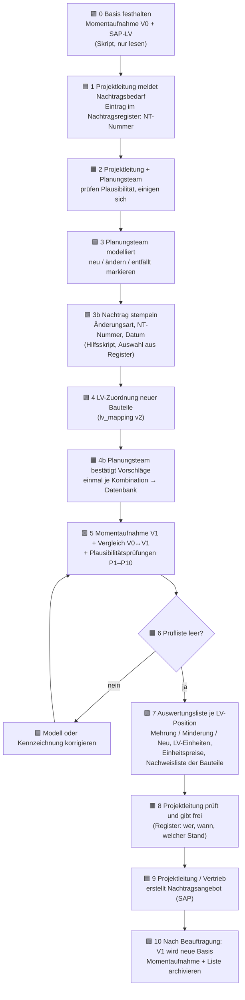

# Potenzialanalyse: Nachtragserfassung im BIM-Modell (Gebäudeautomation)

> **Zweck:** Entscheidungsgrundlage für die Bachelorarbeit. Hier wird **noch nichts Endgültiges gebaut**. Es gibt in diesem Dokument keinen neuen Code; Prototypen folgen erst nach Klärung der offenen Fragen (Kapitel 10).
>
> **Quellen:**
> - Besprechungsnotizen mit einer BIM-Expertin bei Siemens zum Nachtragsvorgehen in einem **anderen** Projekt. Die Notizen sind KI-generiert und vom Anwender bereitgestellt; sie liegen nicht im öffentlichen Repository.
> - `konzept/KONZEPT_ENTSCHEIDUNG.md`
> - `konzept/DIAGNOSE_AUSWERTUNG_2.md`
> - `lv_mapping/` (Version 1 und 2)
> - `dynamo/python/` (Modul 2)
> - `shared_parameters/GA_Nachtrag_SharedParameters.txt`
>
> **Kennzeichnung:**
> - **[Beleg]**: steht in einer der Quellen.
> - **[Annahme]**: Vermutung oder Einschätzung, nicht belegt.
> - **[Offen]**: braucht deine Antwort (Kapitel 10).
>
> **Abgrenzung:** Planerparameter (Präfix `ZWP_`) werden nur gelesen, nie beschrieben, und spielen für die Siemens-Leistung keine Rolle.

---

## 0. Kurzfazit

1. **Der größte Hebel ist Schritt 4, die Auswertungsliste.**
   - Mehrung, Minderung und Neu je LV-Position, in LV-Einheiten und mit LV-Preisen, lassen sich **vollständig mit Dynamo/Python** erzeugen.
   - Das Ergebnis ist eindeutig, wiederholbar und prüfbar. Heute entsteht eine solche Liste gar nicht **[Beleg: Besprechung, deine Aussage]**.
   - Voraussetzung ist, dass jedes Bauteil seiner LV-Position zugeordnet ist. Das leistet `lv_mapping` (v2) bereits zum großen Teil.
2. **Schritt 3, das Modellieren, bleibt Handarbeit.** Ein kleines Hilfsskript kann aber das Kennzeichnen der Nachtragsbauteile (Nummer, Änderungsart, Datum) **in einem Klick** erledigen. Das senkt Tippfehler deutlich **[Annahme]**.
3. **Schritt 5, das Angebot, bleibt eine kaufmännische Entscheidung** von Projektleitung bzw. Vertrieb. Das Skript liefert nur eine prüfbare Vorlage mit Mengen, Einheitspreisen und Beträgen.
4. **Eine KI ist für den Kern nicht nötig.** Vergleich, Mengen, Gruppierung, Preise und Plausibilitätsregeln sind **feste Rechenregeln**. Eine KI würde dort nur Unsicherheit hinzufügen.
   - Echten, aber kleinen Mehrwert hat eine KI an zwei Stellen: bei der **Zuordnung unklarer Bauteile** zu LV-Positionen (Vorschlag, Mensch bestätigt) und bei **Textentwürfen für neue LV-Positionen**, die es im LV noch nicht gibt.
   - Beides ist selten und muss immer geprüft werden.
   - Ehrliche Einordnung: In der Arbeit sollte KI als **optionale Unterstützung** erscheinen, nicht als tragender Teil.
5. **Empfohlene Auswertung: die Kombination** aus Modellstand-Vergleich (A) und Nachtragsparametern am Bauteil (B).
   - A rechnet die Mengen und ist robust gegen vergessene Kennzeichnung.
   - B ordnet Änderungen einem Nachtrag zu.
   - Der Abgleich beider zeigt Pflegefehler automatisch.

---

## 1. Begriffe kurz erklärt

| Begriff | Bedeutung |
|---|---|
| **Nachtrag** | Zusätzliche oder geänderte Leistung gegenüber dem beauftragten LV, die dem Auftraggeber angeboten wird |
| **LV-Position** | Zeile im Leistungsverzeichnis mit Nummer, Kurztext, Einheit und Einheitspreis |
| **LV-Einheit** | Einheit, in der abgerechnet wird, z. B. Stück (ST) oder Meter (m) |
| **Mehrung / Minderung** | mehr bzw. weniger Menge einer bestehenden LV-Position |
| **Neu** | Leistung, die es im LV noch nicht gibt (neue LV-Position nötig) |
| **Masterposition** | LV-Position, die mehrere Unterpositionen bündelt (n Bauteile → 1 Position) |
| **Momentaufnahme (Snapshot)** | Datei (CSV), die den Inhalt eines Modellstands festhält: welche Bauteile, welche LV-Position, welche Menge |
| **UniqueId** | Revit-interne, dauerhafte Kennung eines Bauteils; bleibt über Modellstände gleich |
| **Exemplar- / Typparameter** | Wert am einzelnen Bauteil bzw. an der Bauart (gilt für alle gleichen Bauteile) |
| **Schlüsselbauteilliste** | Revit-Funktion, mit der ein Parameter eine feste Auswahlliste bekommt (Dropdown) |
| **Plausibilitätsprüfung** | automatische Regel, die widersprüchliche oder unvollständige Angaben findet |

---

## 2. Prozessabgleich: dein Verständnis gegen die Besprechungsnotizen

| Schritt (dein Verständnis) | Notizen sagen | Abgleich |
|---|---|---|
| 1. Projektleitung überlegt Nachtragsleistungen und übergibt sie dem Planungsteam | nicht beschrieben | **[Annahme]**, in den Notizen nicht belegt |
| 2. Projektleitung und Planungsteam prüfen gemeinsam die Plausibilität | nicht beschrieben | **[Annahme]** |
| 3. Planungsteam modelliert: neu, geändert, entfallend; Entfallendes wird über Filter ausgeblendet | Änderungen werden über die Projektparameter **„Änderungsdatum“** und **„Änderungsart“** dokumentiert (z. B. „Verschiebung“, „gelöscht“). Gelöschtes wird **markiert statt gelöscht** und per Filter ausgeblendet. Pläne werden zusätzlich mit roten Kreisen oder Wolken markiert. | **[Beleg]**, stimmt überein. Ergänzung: Die Dokumentation erfolgt über **zwei Parameter**, nicht nur über Filter. |
| 4. Auswertungsliste Mehrung/Minderung/Neu | Es wird eine **Bauteilliste exportiert**, „um gelöschte und geänderte Elemente zu überblicken“. Es gibt außerdem eine offizielle Projektliste (SharePoint) für alle Beteiligten. | **Abweichung:** Die Liste ist eine **Bauteil**-Übersicht. Es gibt **keine** Bewertung je LV-Position, keine LV-Einheiten und keine Preise. Mehrung/Minderung entsteht nicht. |
| 5. Projektleitung/Vertrieb erstellt daraus den Nachtrag | nicht beschrieben | **[Annahme]** |
| Zuordnung zu einem bestimmten Nachtrag | Parameter „Nachtragsnummer“ wurde nur **theoretisch** vorgeschlagen, **nicht praktisch** angewendet | **[Beleg]**: Lücke |
| Umbauphasen | als Idee diskutiert; für Feldgeräte praktikabel, für große Kanalnetze wegen Modellgröße weniger | **[Beleg]** |
| Einsatzbereich | Feldgeräte, Werkmontageplanung, Leistungsphase 8 | **[Beleg]**, gilt als Grenze des Konzepts |

**Wichtigste Erkenntnis:** Schritt 3 ist in der Praxis teilweise vorhanden. Der Übergang von „Bauteile sind markiert“ zu „Nachtrag in LV-Positionen mit Mengen und Preisen“ fehlt dagegen ganz. Genau dort setzt die Arbeit an.

---

## 3. Potenzialtabelle je Teilschritt

Bewertung: **Nutzen** = Zeitersparnis bzw. weniger Fehler; **Aufwand** = Entwicklung + Einführung; **Risiko** = was passiert, wenn das Werkzeug falsch liegt.

> **Vorbehalt:** Wie viel Zeit Schritt 4/5 heute kostet, ist **unbekannt** (Frage F1). Der Nutzen ist deshalb relativ eingeschätzt, nicht in Stunden.

| Nr. | Teilschritt | Nutzen | Aufwand | Risiko | Zuverlässigkeit | Werkzeug | KI nötig? |
|---|---|---|---|---|---|---|---|
| 3.1 | Nachtragsbauteile modellieren (neu setzen, Typ tauschen, verschieben) | – | – | – | – | **manuell** | nein. Fachliche Planungsarbeit, nicht automatisierbar. |
| 3.2 | Nachtragsbauteile kennzeichnen (Nummer, Änderungsart, Datum) | mittel: weniger Tippfehler, einheitliche Werte | gering | gering | hoch | **Dynamo**-Hilfsskript „Nachtrag stempeln“ + Auswahlliste (Schlüsselbauteilliste) | nein |
| 3.3 | Entfallendes markieren statt löschen | – | – | – | – | **manuell** (Änderungsart = „entfällt“) | nein. Hart Gelöschtes findet trotzdem der Vergleich (4.1). |
| 4.1 | **Vergleich zweier Modellstände** | **hoch**: findet alle Änderungen inkl. hart gelöschter Bauteile, Typwechsel und Längenänderungen | mittel | mittel (falsche Basis = falscher Nachtrag) | hoch, wenn die Basis stimmt | **Dynamo** (Momentaufnahme) + **Python** (Vergleich) | **nein**. Mengenvergleich ist reine Rechnung. |
| 4.2 | **Zuordnung Bauteil → LV-Position** | **hoch**: Voraussetzung für alles Weitere | mittel (Datenbank pflegen) | mittel (falsche Position = falscher Preis) | hoch für „Modell“-Treffer, mittel für Vorschläge | **Dynamo** (`lv_mapping` v2) | **teilweise**: nur für Bauteile ohne eindeutigen Treffer als Vorschlag (Copilot). Mehrwert gering bis mittel, abhängig vom Anteil unklarer Bauteile. |
| 4.3 | Mengen in LV-Einheiten, Gruppierung je LV-Position, n:1 | **hoch** | gering | gering | hoch | **Python** | nein |
| 4.4 | Preise aus dem LV ergänzen (Menge × Einheitspreis) | hoch | gering | mittel (veralteter LV-Stand) | hoch | **Python** (SAP-LV einlesen) | nein |
| 4.5 | **Plausibilitätsprüfungen** (Kapitel 3.1) | **hoch**: findet Pflegefehler, bevor sie Geld kosten | gering | gering | hoch, die Regeln sind eindeutig | **Python** | **nein**. Regeln sind fest formulierbar. Eine KI könnte höchstens Freitext-Widersprüche finden (z. B. Bemerkung „entfällt“, Status leer). Das ist ein seltener Randfall. |
| 4.6 | Auswertungsliste als Excel/PDF | hoch | gering | gering | hoch | **Python** (CSV/XLSX); PDF über Excel „Speichern als PDF“ | nein |
| 5.1 | Nachtragsangebot erstellen (Preise, Nachlässe, Angebotstext, SAP) | – | – | hoch (vertragsrelevant) | – | **manuell** (Projektleitung/Vertrieb) | nein |
| 5.2 | Textentwurf für **neue** LV-Positionen (Produkt nicht im LV) | gering bis mittel; Häufigkeit unbekannt | gering | mittel (fachlich falscher Text) | mittel | **KI** (Copilot) als Entwurf, Mensch prüft | **ja, als Option**. Für Siemens-Produkte liefert SAP bereits Kurztexte **[Beleg: SAP-Beispiel]**. Eine KI hilft nur bei Sonderleistungen. |
| 5.3 | Rückverfolgbarkeit (welches Bauteil, welcher Nachtrag, welcher Stand, wer hat freigegeben) | **hoch** für Nachweis und Streitfälle | gering | gering | hoch | **Python** (Momentaufnahmen archivieren) + **Nachtragsregister** (Excel) | nein |

### 3.1 Plausibilitätsprüfungen (Vorschlag)

| Nr. | Regel | Typischer Fehler |
|---|---|---|
| P1 | Änderungsart gesetzt, aber keine Nachtragsnummer | Nummer vergessen |
| P2 | Nachtragsnummer gesetzt, aber keine Änderungsart | Art vergessen |
| P3 | Vergleich zeigt eine Änderung (neu, entfallen, Typwechsel, Menge), am Bauteil ist nichts dokumentiert | **undokumentierte Änderung** |
| P4 | Am Bauteil ist eine Änderung dokumentiert, der Vergleich zeigt keine | Kennzeichnung aus altem Nachtrag stehen geblieben oder falsches Bauteil gekennzeichnet |
| P5 | Bauteil im Siemens-Umfang ohne LV-Position | Zuordnung fehlt |
| P6 | Bauteil fehlt im neuen Stand (hart gelöscht statt markiert) | Hinweis; wird trotzdem als Minderung gezählt |
| P7 | Nachtragsnummer nicht im Nachtragsregister oder im falschen Format | Tippfehler |
| P8 | Kennzeichnung an einer verschachtelten Unterfamilie statt am Hauptbauteil | doppelte oder falsche Zählung |
| P9 | Dieselbe LV-Position hat im selben Nachtrag Mehrung **und** Minderung | Hinweis auf Austausch; korrekt, aber prüfen |
| P10 | Bauteil hat Änderungsart „entfällt“ und ist in derselben Ansicht trotzdem sichtbar | Ausblendfilter arbeitet nicht nach diesem Parameter |

---

## 4. Parameter für die Modellierung von Nachträgen

### 4.1 Kritische Prüfung der vorhandenen Vorschläge (`shared_parameters/GA_Nachtrag_SharedParameters.txt`)

| Vorhandener Parameter | Urteil | Begründung |
|---|---|---|
| `LV_Positionsnummer` | **behalten** | Zuordnung zur LV-Position; einheitlich für Modul 1 und 2 (Konzept 5.4) |
| `LV_Kurztext` | **weglassen** | steht im SAP-LV; eine Kopie im Modell veraltet und ist doppelte Pflege |
| `Basismengeneinheit` | **weglassen** | steht im SAP-LV, gleiche Begründung |
| `Einheitspreis` | **weglassen, ausdrücklich** | Preise gehören nicht ins Modell. Das Modell wird mit Planern und anderen Beteiligten geteilt, Preise sind vertraulich und ändern sich je LV-Stand. Die Auswertung holt sie aus dem SAP-LV. |
| `Nachtrag_ElementGUID` | **weglassen** | Revit hat die UniqueId bereits. Eine Kopie als Parameter ist sogar **gefährlich**: Beim Kopieren eines Bauteils wird der Parameterwert mitkopiert, und zwei Bauteile hätten dieselbe „GUID“. |
| `Nachtrag_Status` (NEU_ELEMENT, MEHRUNG, MINDERUNG, AUSTAUSCH, UNVERAENDERT) | **ersetzen** | Das ist ein **Rechenergebnis** des Vergleichs und gehört in die Auswertungsliste, nicht ins Modell, denn dort würde es beim nächsten Stand veralten. Gebraucht wird stattdessen die **Eingabe** des Planungsteams: die Änderungsart (4.2). |
| `Nachtrag_Erstversion` | **weglassen** | lässt sich aus den Momentaufnahmen ablesen (erster Stand, in dem die UniqueId vorkommt) |
| `Nachtrag_Nummer` | **behalten** (Bedeutung präzisiert, 4.2) | Zuordnung zu einem Nachtrag. Laut Besprechung bisher nur Idee, nicht praktiziert **[Beleg]** |
| `Nachtrag_Freigabestatus` (offen, geprüft, genehmigt) | **ins Nachtragsregister verlegen** | Freigegeben wird ein **Nachtrag**, nicht jedes einzelne Bauteil. Eine Freigabe je Bauteil wäre Mehrfachpflege mit hoher Fehlerquote. |
| `Nachtrag_Bemerkung` | **behalten, optional** | Begründung bzw. Freitext; hilfreich für den Nachweis, keine Pflicht |

### 4.2 Empfohlenes Parameterset

> **Namen [Annahme]:** In der Besprechung werden „Änderungsart“ und „Änderungsdatum“ bereits als Projektparameter verwendet. Wenn diese in den Siemens-Vorlagen schon existieren, sollten **genau diese** verwendet werden, statt neue anzulegen (Frage F2). Falls nicht, werden sie als **gemeinsam genutzte Parameter** angelegt, damit Bauteillisten, Beschriftungen und Skripte sie lesen können.

| Parameter | Datentyp | Ebene | zulässige Werte | wer setzt | wozu für die Auswertung | Fehlerrisiko und Gegenmaßnahme |
|---|---|---|---|---|---|---|
| **`Änderungsart`** | Text, als Auswahlliste über Schlüsselbauteilliste | Exemplar | leer (= Bestand), `neu`, `geändert`, `entfällt` | Planungsteam (Hilfsskript „Nachtrag stempeln“) | „entfällt“ = zählt nicht mehr mit; dieselbe Regel steuert den **Ausblendfilter** der Siemens-Ansichten; Abgleich P1–P4 | Freitext-Tippfehler → Auswahlliste bzw. Stempel-Skript; Pflichtprüfung P2 |
| **`Nachtrag_Nummer`** | Text | Exemplar | Format laut Register, z. B. `NT-01`, `NT-02` **[Annahme, F3]** | Planungsteam (Stempel-Skript übernimmt sie aus dem Register) | ordnet Änderungen einem Nachtrag zu; Auswertung „je Nachtrag“ | falsches Format oder unbekannte Nummer → Auswahl nur aus dem Register, Prüfung P7 |
| **`Änderungsdatum`** | Text (Revit kennt kein Datumsfeld), Format `JJJJ-MM-TT` | Exemplar | Datum | **automatisch** durch das Stempel-Skript | Nachvollziehbarkeit; Plausibilität gegen das Datum der Momentaufnahme | von Hand uneinheitlich → nur per Skript setzen |
| `Nachtrag_Bemerkung` | Text | Exemplar | Freitext | Planungsteam, optional | Begründung im Nachweis | gering |
| `LV_Positionsnummer` | Text | Exemplar | LV-Ordnungszahl | **automatisch** (`lv_mapping` v2); unklare Fälle bestätigt das Planungsteam einmal in der Datenbank | Gruppierung je LV-Position | falsche Zuordnung → Vorschlagsliste, Mensch bestätigt; Schreiben nur, wenn erlaubt (sonst nur in der Momentaufnahme) |

**Nicht im Modell, sondern im Nachtragsregister (Excel, eine Zeile je Nachtrag):** Nachtragsnummer, Titel, Anlass, Datum, Basis-Stand, Nachtrags-Stand, Status (`in Bearbeitung`, `geprüft`, `freigegeben`, `beauftragt`, `abgelehnt`), freigegeben von, Datum der Freigabe.

### 4.3 Wie die Sonderfälle abgebildet werden

| Fall | Lösung |
|---|---|
| **„Entfallen“ unabhängig von der Sichtbarkeit** | `Änderungsart` = `entfällt`. Die Auswertung liest nur den Wert, nie die Ansicht. Die Siemens-Ansichtsvorlagen bekommen einen Filter „Änderungsart = entfällt → ausblenden“. Damit arbeiten Filter und Auswertung nach **demselben** Parameter. Planerfilter (`ZWP_`) werden nicht angefasst. |
| **Bauteil von mehreren Nachträgen betroffen** (erst NT-01, dann NT-02) | Am Bauteil steht nur der **letzte** Nachtrag. Die Geschichte steckt in den archivierten Momentaufnahmen und Auswertungslisten je Nachtrag, denn jede Momentaufnahme hält den damaligen Wert fest. Eine Liste mehrerer Nummern in einem Feld („NT-01;NT-02“) ist fehleranfällig und wird nicht empfohlen. |
| **Mehrere Bauteile, eine LV-Position (n:1, Masterposition)** | Zusammengezählt wird **je LV-Position**. Nebenbauteile eines Sets bekommen in der Typ-Tabelle Mengenfaktor 0 (Konzept 5.3/6.5). Bewertet wird je Unterposition, weil auch Teile einer Masterposition nachträglich beauftragt werden können **[Beleg: deine Antwort]**. |
| **Bewertung in LV-Einheiten** | Menge je Position = Summe aus Grundmenge × Mengenfaktor (Stück, Länge …), nicht Anzahl Bauteile |
| **Typwechsel** | Die UniqueId bleibt gleich, die LV-Position ändert sich → Minderung der alten **und** Mehrung der neuen Position. Das erkennt **nur der Modellstand-Vergleich**, weil der alte Typ nur in der alten Momentaufnahme steht. |
| **Planerparameter `ZWP_`** | werden weder gelesen noch beschrieben |

---

## 5. Auswertungswege im Vergleich

- **A – Momentaufnahmen-Vergleich:** Zwei Modellstände werden als CSV festgehalten und verglichen (Modul 2).
- **B – statusbasiert:** Die Auswertung liest nur die Nachtragsparameter am Bauteil (Änderungsart, Nachtragsnummer) im aktuellen Modell.

| Kriterium | A Vergleich | B Status | **A + B kombiniert** |
|---|---|---|---|
| findet neue Bauteile | ja | nur wenn gekennzeichnet | ja |
| findet hart gelöschte Bauteile | **ja** | **nein**: sie sind weg | ja |
| findet Typwechsel (alte und neue Position) | **ja** | **nein**: alte Position unbekannt | ja |
| findet Mengenänderung ohne neues Bauteil (z. B. längere Trasse) | ja | nein | ja |
| ordnet Änderung einem **bestimmten** Nachtrag zu | nur, wenn zwischen zwei Momentaufnahmen genau **ein** Nachtrag modelliert wurde | **ja** | **ja** |
| robust gegen vergessene Kennzeichnung | **ja** | nein: fehlt im Nachtrag, das kostet Geld | ja, und P3 zeigt die Lücke |
| nötige Disziplin des Planungsteams | gering (nur der Zeitpunkt der Momentaufnahme) | **hoch**: jede Änderung kennzeichnen, später zurücksetzen | mittel: Kennzeichnung, Fehler werden aber gemeldet |
| Nachweis und Rückverfolgbarkeit | gut (archivierte Stände) | mäßig: Werte im Modell werden überschrieben | sehr gut |
| Aufwand | mittel | gering | mittel |
| Begründbarkeit in der Arbeit | gut | schwach: hängt an Disziplin, Typwechsel nicht lösbar | **sehr gut**: zwei unabhängige Quellen, gegenseitige Prüfung, messbare Fehlerquote |

**Empfehlung: Kombination.**
- **A ist die rechnende Grundlage**, denn es zählt, was im Modell tatsächlich ist.
- **B liefert die Zuordnung zum Nachtrag** und die Absicht des Planungsteams.
- Wo beide sich widersprechen, entsteht eine Prüfliste (P3, P4). Das ist zugleich die beste Kennzahl für die Arbeit.
- **Sonderfall:** Wird zwischen zwei Momentaufnahmen immer nur **ein** Nachtrag modelliert, reicht A allein für die Mengen. B dient dann nur der Dokumentation (Frage F5).

---

## 6. Soll-Prozess

Legende: 🟦 manuell · 🟩 Skript (automatisch) · 🟧 Prüfung bzw. Freigabe durch einen Menschen

| Schritt | Rolle | Parameter / Daten | Art |
|---|---|---|---|
| 0 Basis festhalten | Planungsteam startet Skript | Momentaufnahme V0, SAP-LV | 🟩 |
| 1 Bedarf melden | Projektleitung | Nachtragsregister (NT-Nummer, Anlass) | 🟦 |
| 2 Plausibilität | Projektleitung + Planungsteam | – | 🟧 |
| 3 Modellieren | Planungsteam | Bauteile im Modell | 🟦 |
| 3b Stempeln | Planungsteam startet Skript | `Änderungsart`, `Nachtrag_Nummer`, `Änderungsdatum` | 🟩 |
| 4 / 4b LV-Zuordnung | Skript / Planungsteam bestätigt | `LV_Positionsnummer`, Datenbank | 🟩 + 🟧 |
| 5 / 6 Vergleich + Prüfung | Skript / Planungsteam klärt | Momentaufnahme V1, Prüfliste | 🟩 + 🟧 |
| 7 Auswertungsliste | Skript | Excel/PDF | 🟩 |
| 8 Freigabe | Projektleitung | Register: Status `freigegeben` | 🟧 |
| 9 Angebot | Projektleitung / Vertrieb | SAP | 🟦 |
| 10 Neue Basis | Skript / Planungsteam | Archiv | 🟩 |

---

## 7. Machbarkeit: Minimalprototyp und Test

### 7.1 Kleinste sinnvolle Version

| Baustein | Inhalt | schreibt ins Modell? |
|---|---|---|
| Momentaufnahme | Dynamo-Skript: je Bauteil der gewählten Kategorien UniqueId, Element-ID, Familie, Typ, Modell, Länge (falls vorhanden), `Änderungsart`, `Nachtrag_Nummer`, verschachtelt ja/nein → CSV | **nein** |
| Zuordnung | vorhandenes `lv_mapping` v2 bzw. dessen Logik **im Speicher** (Datenbank + SAP-LV) | **nein** (nur Ergebnis in der CSV) |
| Vergleich + Liste | Python-Skript ohne Revit: liest V0, V1 und SAP-LV → Auswertungsliste je LV-Position mit Einheitspreis und Betrag + Prüfliste P1–P6 | **nein** |

**Bewusst noch nicht enthalten:**
- Stempel-Skript
- Schlüsselbauteillisten
- Schreiben von `LV_Positionsnummer`
- PDF
- KI

So kann der Minimalprototyp **nichts im Modell beschädigen**.

### 7.2 Risikofrei testen

1. Mit einer **Kopie** arbeiten:
   - in Revit „Datei“ → „Speichern unter“,
   - beim Öffnen „Vom Zentralmodell lösen“ wählen,
   - oder ein kleines Testmodell mit 20–50 GA-Bauteilen verwenden.
2. Momentaufnahme **V0** ziehen. Das Skript liest nur.
3. In der Kopie einen **Test-Nachtrag mit bekannter Lösung** modellieren:
   - 3 Bauteile neu,
   - 1 Typwechsel,
   - 2 Bauteile auf „entfällt“ setzen,
   - 1 Bauteil hart löschen,
   - 1 Änderung absichtlich **nicht** kennzeichnen.
4. Momentaufnahme **V1** ziehen, Vergleich laufen lassen.
5. Ergebnis gegen die bekannte Lösung prüfen. Alle 8 Fälle müssen erkannt werden, der nicht gekennzeichnete als P3.

Das ist zugleich ein **kontrolliertes Experiment** für die Bachelorarbeit: Die richtige Antwort ist vorher bekannt.

Vorab teste ich alle Skripte mit Beispieldaten. **Der Test in echtem Revit steht dann bei dir aus.**

### 7.3 Benötigte Daten

| von dir | von mir |
|---|---|
| SAP-LV-Export (.xlsx) des Testprojekts; Preise bleiben auf deinem Rechner | Momentaufnahme-Skript (.dyn), Vergleichsskript, Anleitung in Einzelschritten |
| deine Datenbank-CSV (Modell → LV-Nummer) | Testdaten und Mock-Test für den Vergleich |
| Kopie oder Testmodell + Liste der Teständerungen (7.2) | Vorlage für das Nachtragsregister (Excel) |
| Antworten auf F1–F6 | Auswertung des Testlaufs |

---

## 8. Stufenplan und Kennzahlen

### 8.1 Stufenplan

| Stufe | Inhalt | Ergebnis |
|---|---|---|
| **1 Minimal** | Momentaufnahme + Vergleich + Auswertungsliste (7.1), nur lesen | erste Nachtragsliste je LV-Position aus einem Testfall |
| **2 Kennzeichnung** | Parameter `Änderungsart`, `Nachtrag_Nummer`, `Änderungsdatum` einführen; Filter „entfällt“ in Siemens-Ansichtsvorlagen; Prüfregeln P1–P10 | Kombination A + B |
| **3 Komfort** | Stempel-Skript; Auswahllisten über Schlüsselbauteillisten; Nachtragsregister | weniger Pflegefehler |
| **4 Ausbau** | `LV_Positionsnummer` ins Modell schreiben (falls erlaubt); PDF-Bericht; Copilot-Vorschläge für unklare Zuordnungen und Texte neuer Positionen | Komfort, KI optional |

### 8.2 Kennzahlen für die Bachelorarbeit

| Kennzahl | Formel / Messung | Quelle |
|---|---|---|
| **Zeit je Nachtrag** | Minuten von „Modellierung fertig“ bis „Auswertungsliste liegt vor“, heute gegen Prototyp | Zeitmessung; heutiger Wert aus F1 |
| **Erkennungsquote** | im Testfall erkannte Änderungen ÷ tatsächliche Änderungen | Testfall 7.2 |
| **Falschklassifikation** | falsch eingeordnete Änderungen ÷ alle erkannten | Testfall 7.2 |
| **Prüfquote** | Einträge der Prüfliste ÷ alle Änderungen | Skriptbericht |
| **Dokumentationsquote** | erkannte Änderungen mit gepflegter `Änderungsart` und `Nachtrag_Nummer` ÷ alle erkannten Änderungen | Abgleich A ↔ B |
| **Zuordnungsquote** | Nachtragsbauteile mit sicherer LV-Position ÷ alle Nachtragsbauteile | `lv_mapping` v2 |
| **Betragsabweichung** | Betrag laut Liste gegen manuell erstellten Nachtrag (falls ein Vergleichsnachtrag existiert) | F7 |
| **Pflegeschritte je Änderung** | Anzahl manueller Eingaben je geändertem Bauteil, heute gegen Soll | Prozessvergleich |

---

## 9. Annahmen

1. Schritte 1, 2 und 5 des Prozesses laufen wie von dir beschrieben ab. In den Besprechungsnotizen stehen sie nicht.
2. Die Besprechungsnotizen sind KI-generiert und geben das Gespräch sinngemäß richtig wieder.
3. „Änderungsart“ und „Änderungsdatum“ sind Siemens-Praxis, aber ob sie projektübergreifend in einer Vorlage stehen, ist unbekannt.
4. Das Planungsteam darf im Nachtragsmodell eigene Parameter anlegen und befüllen. Im untersuchten Planermodell ist das ungeklärt.
5. Die Grenzen der Punktzahlen und Auswahllisten-Werte sind Vorschläge und nach ersten Tests anzupassen.
6. Ein Stempel-Skript senkt Tippfehler. Belegt wäre das erst durch einen Vergleich.
7. Für Siemens-Produkte liefert SAP die Kurztexte; KI-Textentwürfe sind nur für Sonderleistungen nötig.
8. Ein Nachtragsregister (Excel) ist organisatorisch zulässig. Möglicherweise gibt es dafür schon ein Werkzeug, z. B. die offizielle Projektliste.

---

## 10. Offene Fragen an dich (nach Wichtigkeit)

| Nr. | Frage | Warum wichtig |
|---|---|---|
| **F1** | Wie entsteht ein Nachtragsangebot **heute**? Wer erstellt es, mit welchem Werkzeug (Excel, SAP, Word), und **wie lange** dauert es von „Änderung modelliert“ bis „Angebot fertig“ (grob in Stunden)? | ohne diese Zahl kein belegbarer Nutzen (Kennzahl „Zeit je Nachtrag“) |
| **F2** | Gibt es `Änderungsart` und `Änderungsdatum` in einer Siemens-Vorlage (Name, Werte, Projekt- oder gemeinsam genutzter Parameter)? | entscheidet, ob wir vorhandene Parameter nutzen oder neue anlegen |
| **F3** | Wie werden Nachträge nummeriert, und wo werden sie verwaltet (SAP, Excel, offizielle Projektliste)? | Format und Quelle für `Nachtrag_Nummer` und das Register |
| **F4** | In welchem Modell würde Siemens Nachträge modellieren: im eigenen Werkmontagemodell oder im Planermodell? Wer darf dort Parameter anlegen und Ansichtsvorlagen ändern? | bestimmt, ob Kennzeichnung und Filter überhaupt möglich sind |
| **F5** | Können **mehrere** Nachträge gleichzeitig in Bearbeitung sein (parallel im Modell)? | bei „ja“ ist B (Nachtragsnummer) zwingend, bei „nein“ reicht A für die Mengen |
| **F6** | Wie werden Modellstände versioniert (Cloud mit Versionen, Dateien mit Index)? Wann gilt ein Stand als „Basis“? | Zeitpunkt der Momentaufnahmen |
| **F7** | Gibt es einen bereits erstellten Nachtrag (mit Modellständen davor und danach), den man als Vergleich nehmen könnte? | ermöglicht die Kennzahl „Betragsabweichung“ |
| **F8** | Welche Preise gelten für Mehrungen: Einheitspreise aus dem LV oder eine neue Kalkulation? Darf die Auswertungsliste Preise enthalten? | Inhalt und Vertraulichkeit der Liste |
| **F9** | Welche Spalten braucht Projektleitung bzw. Vertrieb in der Auswertungsliste? Gibt es eine Vorlage? | Format der Ausgabe |
| **F10** | Steht ein Testmodell oder eine Kopie mit GA-Bauteilen für den Test (7.2) zur Verfügung? | Voraussetzung für den Minimalprototyp |
